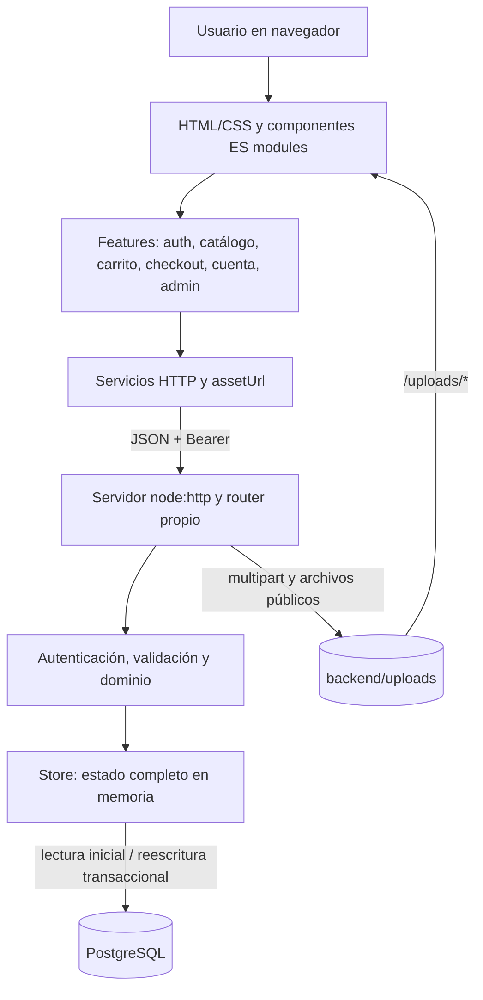

# Arquitectura

GlobalizaT es una aplicación web de tres capas para una demostración académica local. El frontend usa módulos nativos del navegador, el backend se apoya en `node:http` y PostgreSQL almacena el estado relacional.

## Capas

## Flujo de una solicitud

1. La interfaz llama a un servicio de `src/services/` o `src/features/account/services/`.
2. `apiRequest` construye la URL sobre `API_BASE_URL`, serializa JSON y añade `Authorization: Bearer <token>` cuando existe sesión.
3. El servidor aplica CORS, decodifica la ruta y lee JSON o multipart con un límite bruto de 110 MB.
4. El router compara método y patrón, extrae parámetros y ejecuta middlewares.
5. `requireAuth` resuelve la sesión en memoria; `requireAdmin` valida el rol.
6. La ruta valida los datos y lee o modifica el store.
7. Toda escritura del store reescribe las tablas de aplicación dentro de una transacción PostgreSQL.
8. La API responde JSON; los errores controlados usan `{ "error": "…", "code": "…" }`.

## Modelo de persistencia

Al iniciar, el backend abre un pool `pg`, aplica `backend/src/db/schema.sql` y carga todas las entidades en un único estado en memoria. Si `users` está vacía, utiliza un JSON legado compatible, cuando existe, o genera la semilla. Cada `commit` se serializa y persiste el estado completo en una transacción.

Este modelo facilita la demostración y mantiene coherencia entre servicios, pero está diseñado para una sola instancia y un volumen pequeño. No existe un sistema de migraciones incremental.

La creación de pedidos realiza dos validaciones de precio y stock, y descuenta inventario en el mismo commit. La restricción única `(user_id, request_id)` y la comprobación en el dominio proporcionan idempotencia.

## Autenticación y sesiones

- Las contraseñas se derivan en el servidor con PBKDF2-SHA256, 120 000 iteraciones, salt aleatorio y digest de 256 bits.
- El login devuelve un token aleatorio de 32 bytes representado en hexadecimal.
- Las sesiones residen en un `Map` del proceso y vencen según `SESSION_TTL_HOURS`.
- El frontend conserva el token únicamente en una variable de memoria y lo envía como Bearer token.
- Reiniciar el backend o recargar la página invalida la experiencia de sesión; no hay cookie, refresh token ni persistencia de sesión.
- Los roles efectivos son `customer` y `admin`.

## Flujo de medios y assets

1. Administración envía imágenes o GLB por `multipart/form-data`; Cuenta hace lo mismo para el avatar.
2. La API valida tipo y tamaño, genera un nombre aleatorio y escribe bajo `backend/uploads/`.
3. El archivo se registra en `media_files` y la API devuelve una ruta `/uploads/...`.
4. El frontend convierte esa ruta a una URL absoluta con `assetUrl`, usando la misma base de la API.
5. `server.js` sirve `/uploads/*` desde disco con protección contra salida del directorio.
6. Los medios incorporados al repositorio, incluidos los GLB de `src/assets/models/`, se sirven directamente por el servidor del frontend.

Las cargas locales están ignoradas por Git y no se replican en almacenamiento externo.

## Tema

El tema usa variables de diseño en `src/styles/tokens.css`. El script inline de `index.html` aplica antes del render la preferencia guardada en `localStorage` con la clave `uninorte.theme`. Si no existe una elección explícita, `getTheme()` sigue `prefers-color-scheme`; al usar el interruptor de la barra o de la pantalla de login, se fija `light` o `dark` y se emite `themechange`.

## Componentes 3D

`product-model-cache.js` comparte promesas y modelos cargados, `render-budget.js` limita el trabajo de render continuo, `catalog-renderer.js` gestiona la escena del catálogo y `product-viewer.js` crea el visor interactivo del detalle. Los recursos de Three.js r180 están vendorizados y se resuelven mediante el import map de `index.html`.
