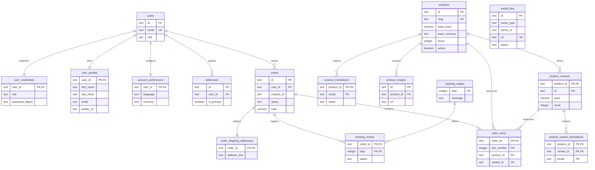

# Base de datos

El backend usa PostgreSQL mediante `pg`. `database/schema.sql` y `backend/src/db/schema.sql` son idénticos (hash SHA-256 verificado: `FAC7FFDFF38ACA8B00C4BF9190655DEEC4FBFBBA1737B0943195CDB19E1B30DC`). No existe un sistema de migraciones: el esquema idempotente se aplica completo en cada arranque.

## Modelo relacional



`media_files.owner_id` es una referencia lógica, no una clave foránea: puede identificar un producto o una cuenta según `owner_type`.

## Tablas y relaciones

| Grupo | Tablas | Propósito |
|---|---|---|
| Identidad | `users`, `user_credentials`, `user_profiles` | Rol/correo de acceso, digest PBKDF2 y datos editables del perfil. |
| Cuenta | `account_preferences`, `addresses` | Idioma, moneda, preferencias y direcciones del usuario. |
| Catálogo | `products`, `product_translations`, `product_images`, `product_variants`, `product_variant_translations` | Datos comerciales, contenido ES/EN, medios y stock por presentación. |
| Pedidos | `orders`, `order_items`, `order_shipping_addresses` | Cabecera, precios históricos, cantidades y snapshot de envío. |
| Seguimiento | `tracking_stages`, `tracking_events` | Catálogo de 15 etapas y eventos materializados. |
| Medios | `media_files` | Metadatos y ciclo activo/liberado de cargas locales. |

## Restricciones e índices clave

- `users.email` y `products.slug` son únicos.
- `role`, idiomas, monedas, disponibilidad, estados de pedido/seguimiento y tipos de asset usan `CHECK`.
- Precios, stock, cantidades y tamaño de medio no pueden ser negativos.
- `uq_addresses_one_primary` es un índice único parcial: máximo una dirección principal por usuario.
- `uq_orders_request_id` garantiza un `request_id` único por usuario cuando no es nulo.
- La FK compuesta de `order_items(product_id, variant_id)` evita asociar una variante con otro producto.
- Productos y variantes referenciados por pedidos usan `ON DELETE RESTRICT`; los pedidos preservan su historia.
- Las traducciones y entidades dependientes usan mayormente `ON DELETE CASCADE`.
- Hay índices para direcciones por usuario, catálogo activo/destacado, disponibilidad, imágenes, stock de variantes, pedidos por usuario/fecha y estado, productos en líneas, tracking y propietarios de medios.

## Dos caminos de siembra

### Automático al iniciar

`createStore` cuenta `users`. Si está vacía, intenta importar `LEGACY_DATA_FILE` cuando tiene la forma esperada; en caso contrario llama a `backend/src/data/seed.js`. Después persiste el estado completo. Es el camino recomendado para la aplicación.

### SQL manual

`database/seed.sql` es una alternativa idempotente para pgAdmin/`psql`. El conjunto saneado y reproducible contiene:

| Entidad | Cantidad verificada |
|---|---:|
| Usuarios | 2 |
| Direcciones | 2 |
| Productos | 6 |
| Traducciones de producto | 12 |
| Variantes | 10 |
| Pedidos | 6 |
| Líneas de pedido | 11 |
| Etapas de seguimiento | 15 |

Los correos de ejemplo pertenecen a datos ficticios, incluido el dominio reservado `example.com`. No hay datos personales reales ni secretos reales.

## Comprobación y reset

Desde `backend/`:

```sh
npm run db:check
```

El comando verifica conexión, versión/usuario, tablas, conteos y claves foráneas no validadas. Oculta la contraseña al imprimir `DATABASE_URL`.

```sh
npm run db:reset
```

El reset trunca las tablas de aplicación con `CASCADE`, conserva `tracking_stages` y destruye los datos de la base configurada. Al volver a iniciar el backend, se carga la semilla si `users` continúa vacía.

## Reproducir desde cero

1. Crea una base vacía `globalizat` con [`../database/00_create_database.sql`](../database/00_create_database.sql) o `createdb`.
2. Define `DATABASE_URL` en `backend/.env`.
3. Elige uno de estos caminos:
   - inicia el backend para aplicar esquema y semilla automática; o
   - ejecuta `database/schema.sql` y luego `database/seed.sql`.
4. Ejecuta `npm run db:check` desde `backend/`.
5. Inicia la plataforma con `npm run start:all`.

Como no hay migraciones, cualquier evolución futura del esquema debe introducir una estrategia explícita antes de operar sobre datos que deban preservarse.
